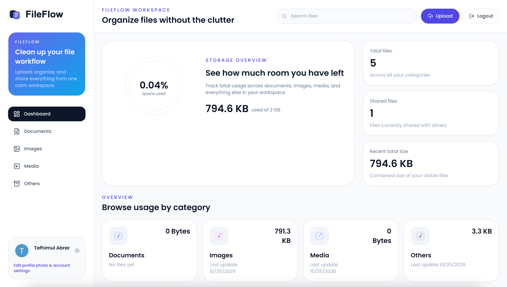
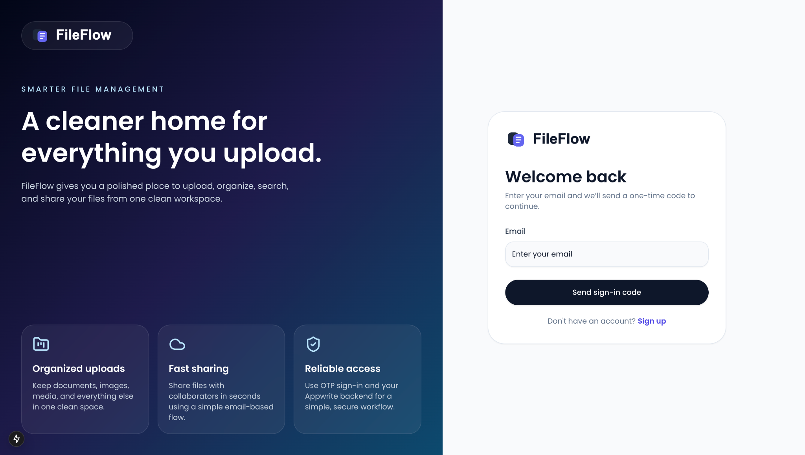
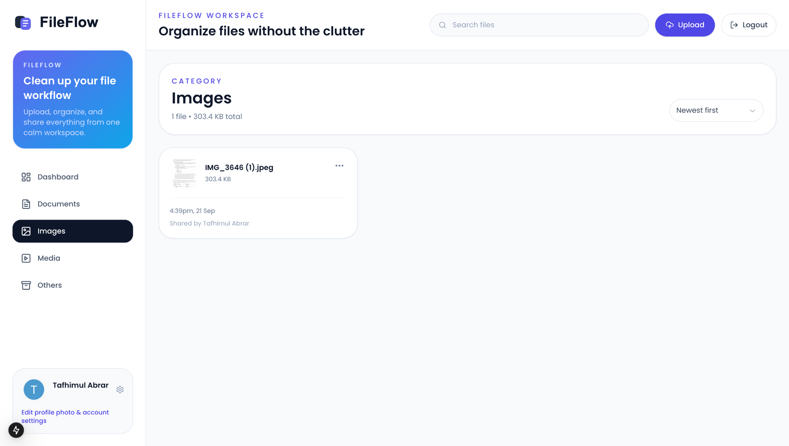
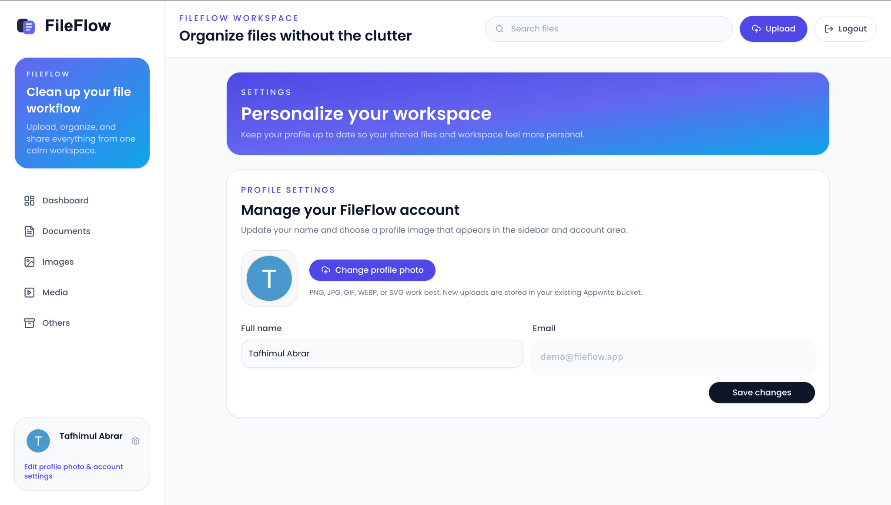

FileFlow
FileFlow is a full-stack cloud file management application that provides a clean and responsive interface for uploading, organizing, searching, sharing, and managing files.

FileFlow combines a Next.js frontend with Appwrite authentication, database services, and cloud storage to provide a complete file-management experience across desktop and mobile devices.
Features
- Email OTP authentication
- Cloud file upload and storage
- File search and sorting
- Document, image, media, and other file categories
- File renaming and deletion
- File sharing between FileFlow users
- Storage usage visualization
- Responsive dashboard
- User profile settings
- Custom profile pictures
- File details and download options
- Responsive desktop and mobile navigation
Screenshots
Dashboard

<table>
  <tr>
    <td width="50%"><strong>Authentication</strong></td>
    <td width="50%"><strong>File Management</strong></td>
  </tr>
  <tr>
    <td></td>
    <td></td>
  </tr>
</table>

Profile Settings

Tech Stack
- Next.js — application framework and routing
- React — component-based user interface
- TypeScript — type-safe application development
- Appwrite — authentication, database, and cloud storage
- Tailwind CSS — responsive styling and interface design
- shadcn/ui — reusable interface components
- Lucide React — interface icons
- Recharts — storage usage visualization
Development
FileFlow was developed by extending an existing storage-management foundation and transforming it into a customized application with its own identity and user experience.

Development work included:
- Creating the FileFlow product identity and visual design
- Redesigning authentication, dashboard, navigation, and file-management interfaces
- Configuring Appwrite authentication, database collections, relationships, and storage
- Implementing and refining user profile management
- Adding customizable profile images
- Improving authentication feedback and account flows
- Creating custom FileFlow branding and file-type assets
- Debugging authentication, permissions, database schemas, storage, and application configuration
- Refining file sharing, searching, sorting, uploading, renaming, downloading, and deletion workflows
Authentication
FileFlow uses email-based OTP authentication through Appwrite.

Users can create an account with their email, receive a one-time verification code, securely authenticate using that code, and access files associated with their account.

The authentication interface also provides clear feedback for account and sign-in states.
File Management
Users can upload and manage multiple file types, including:
- Documents
- Images
- Videos
- Audio
- Other file formats
Files can be searched, sorted, renamed, downloaded, shared, or deleted directly through the FileFlow interface.
File Sharing
Files can be shared with other FileFlow users through their email addresses.

When a file is shared, the recipient can access it after signing into FileFlow using the associated email address.
Profile Settings
Users can customize their account from the Settings page, including:
- Updating their full name
- Uploading a custom profile picture
Profile images are stored using Appwrite Storage.
Project Structure
app/
├── (auth)/          # Sign-in and sign-up pages
├── (root)/          # Dashboard, file categories, and settings
├── globals.css      # Global styling
└── layout.tsx       # Root application layout

components/
├── ui/              # Reusable UI components
├── AuthForm.tsx
├── FileUploader.tsx
├── Sidebar.tsx
├── Header.tsx
├── Card.tsx
└── ...

lib/
├── actions/         # User and file server actions
├── appwrite/        # Appwrite configuration and clients
└── utils.ts         # Shared helper functions

constants/           # Navigation, file limits, and reusable constants
hooks/               # Reusable React hooks
types/               # TypeScript definitions
public/              # Logos, icons, and static assets
Local Development
Install the project dependencies:
npm install
Create a .env.local file in the root of the project and configure the required Appwrite environment variables:
NEXT_PUBLIC_APPWRITE_ENDPOINT=
NEXT_PUBLIC_APPWRITE_PROJECT=
NEXT_PUBLIC_APPWRITE_DATABASE=
NEXT_PUBLIC_APPWRITE_USERS_COLLECTION=
NEXT_PUBLIC_APPWRITE_FILES_COLLECTION=
NEXT_PUBLIC_APPWRITE_BUCKET=
NEXT_APPWRITE_KEY=
Start the development server:
npm run dev
Open the application at:
http://localhost:3000
Environment Variables
FileFlow requires an Appwrite project with authentication, database collections, and storage configured.

The .env.local file should never be committed to source control.

A .env.example file can be used to document the required environment variable names without exposing private credentials.
Future Improvements
Planned improvements include:
- Favorites and starred files
- Folder organization
- Recently viewed files
- Dark mode
- Improved file previews
- Activity history
- Dedicated shared-with-me view
- Additional sharing controls
- Upload progress indicators
- Improved loading states
- Faster navigation between file categories
Additional development plans are documented in ROADMAP.md.

Author

Tafhimul Abrar

Computer Science student interested in software engineering, full-stack development, artificial intelligence, and data science.